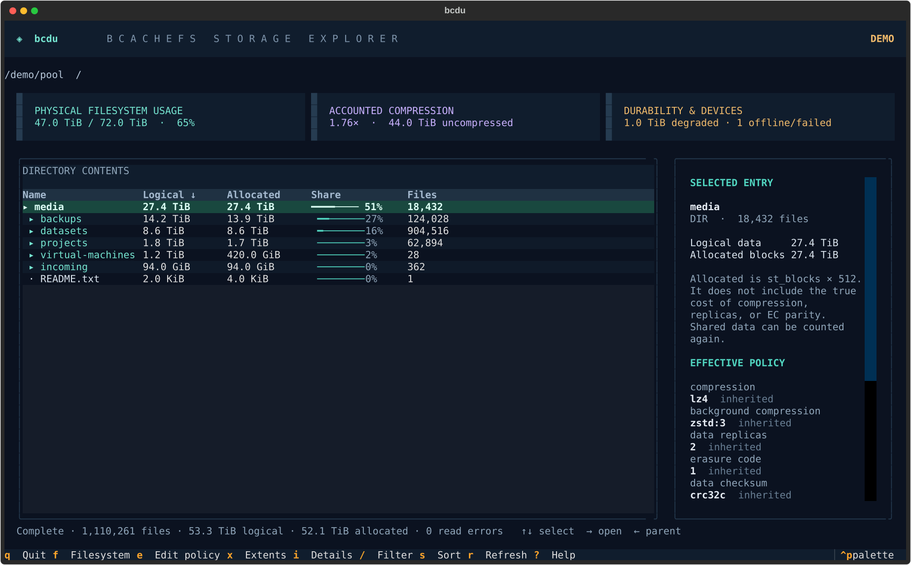
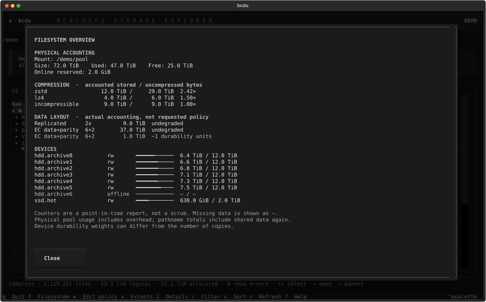

# ◈ bcdu

**A keyboard-first storage explorer for bcachefs.** An ncdu-style browser with a
filesystem dashboard, storage policies, and an editor that shows the scope of a
change before applying it.

[](https://github.com/tom-doerr/bcdu/actions/workflows/tests.yml)
[](LICENSE)



## Install and run

Requires **Linux and Python 3.11+**. Install on the machine that mounts the filesystem:

```sh
uv tool install git+https://github.com/tom-doerr/bcdu.git
bcdu /pool
```

Or use `pipx install git+https://github.com/tom-doerr/bcdu.git`. `bcdu` is not currently
published on PyPI; install from this repository.

```sh
bcdu --demo                              # synthetic data; no filesystem changes
bcdu --read-only /pool                    # disables policy changes
bcdu --bcachefs-bin /path/to/bcachefs /pool
ssh -t your-nas 'bcdu /pool'              # when installed on the NAS
```

Install `bcachefs-tools` separately for pool accounting and policy editing. The app
finds `bcachefs` on `PATH`, then `~/bin/bcachefs`, or uses `--bcachefs-bin`. Ordinary
directory browsing also works on other filesystems; bcachefs-only information is
shown as unavailable. Filesystem operations run with your current permissions;
bcdu does not invoke sudo, mount, repair, or scrub a filesystem.

## What you see

- **Directory browser:** logical bytes, allocated blocks, relative size bars, file
  counts, filtering, sorting, incremental scan progress, and read-error counts.
- **Policy inspector:** effective and explicit compression, background compression,
  data replica count, EC, checksums, and foreground/background/promotion targets.
- **Filesystem dashboard:** actual physical pool usage, per-algorithm compression
  counters and ratios, replicated and EC layouts, degraded allocation, and device
  state, capacity, and usage.
- **File extent inspector:** observed compression algorithms, reported minimum
  durability, EC stripe references, and the underlying extent report. Available
  only when your tools and kernel support online metadata queries and unambiguous
  subvolume/snapshot identification.
- **Policy editor:** preview the option, old/new explicit values, and scope; then
  explicitly apply. Enter `-` to remove an override and restore inheritance.



## Keys

| Key | Action |
| --- | --- |
| **↑ / ↓** | Select entry |
| **→ / Enter** | Enter directory; expand file details |
| **← / Backspace** | Parent directory, within the starting root |
| `h` / `l` | Parent / enter, as alternatives to arrow keys |
| `/` | Filter names in the current directory; Enter returns to rows |
| `s` | Cycle sorting: logical size, allocated blocks, name |
| `i` | Expanded entry details, especially on narrow terminals |
| `f` | Filesystem dashboard |
| `u` | Raw filesystem usage report |
| `x` | Inspect selected file's actual extents |
| `e` | Edit selected file/directory policy |
| `r` | Rescan and refresh accounting |
| `?` | Help and accounting definitions |
| `Esc` | Close dialog or clear filter |
| `q` | Quit |

The side panel hides below 110 columns; `i` still provides all details. Scans run in
the background. Entering a directory starts a fresh scan of that subtree instead
of retaining a metadata object for every file on the NAS.

## What the numbers mean

| Metric | Source and meaning |
| --- | --- |
| Logical data | Sum of regular-file lengths (`st_size`). Includes holes. |
| Allocated blocks | Sum of `st_blocks × 512`. On bcachefs this is **not** the actual compressed/replicated/EC physical footprint. |
| Physical filesystem usage | bcachefs's own `fs usage` counters for the containing filesystem, including filesystem overhead. |
| Compression ratio | Accounted uncompressed bytes divided by compressed bytes. The headline combines reported algorithm rows, including incompressible data. |
| Replicated / EC layout | Actual allocation counters; EC geometry is data + parity. Degraded columns are preserved even when the healthy column is blank. |
| Effective policy | Inode xattrs, with filesystem sysfs defaults for unset attributes. The source is labeled explicit, inherited, or filesystem. Existing extents and descendants can differ. |
| Extent durability | The CLI formatter's reported durability. This is not a scrub or a guarantee of live device health. Device weights can differ from copy counts. |

**Exact exclusive physical bytes and compression ratios per directory are not
available.** Compression blobs can cover partial extents, EC parity is shared,
and reflinks/snapshots share data. bcdu does not manufacture those numbers from
`st_blocks` or divide a directory total by a global compression ratio.

The browser counts each regular-file pathname. Hard links, reflinks, and snapshots
can therefore count shared data more than once. Symlinks and other mounts are
skipped; directory metadata is excluded. Permission errors produce partial totals,
and a scan of a changing tree is not an atomic snapshot. Refresh to rescan.

Unknown or unsupported fields display `—` or an explanation, not a healthy/zero
value. The raw report is available with `u` if a tools version changes its format.

## Changing policies

Select a file or directory and press `e`. Choose an option, enter a value, select
**Preview**, then **Apply change**. Nothing changes before Apply. In demo mode,
changes affect memory only.

The editor uses the separately installed `bcachefs set-file-option` command and
supports the options advertised by that command. It never builds a shell command.
Before applying, it rechecks the selected inode and explicit attribute; afterward
it reads back the root attribute. It reports CLI errors and warnings.

Directory changes use bcachefs's **recursive inheritance propagation** for existing
children, preserving explicit descendant overrides; future children inherit the
directory policy. File changes affect all hard links to the same inode. Existing
data may be rewritten asynchronously. A successful policy edit does not prove that
data conversion finished or that the requested durability is achieved. Recursive
propagation is not atomic; descendants are not individually audited by bcdu, and
an interrupted or failed command may have partially applied. Keep the app open
until the result is shown.

Only inode policies are edited. Device state, filesystem-wide metadata policy,
mount settings, repairs, deletion, and formatting are outside this editor's scope.

## Compatibility and development

Accounting has been checked against live `bcachefs-tools v1.39.4` output with the
newer replicated/EC degradation matrices. Older releases may expose fewer counters.
Text output is parsed conservatively; unsupported reports remain available raw.
Extent inspection additionally requires `BCH_IOCTL_QUERY_BTREE_KEYS`, `STATX_SUBVOL`,
and `subvolume list-snapshots --json`. It refuses ambiguous snapshot queries and
limits command runtime/output. No offline extent access or fsck fallback is used.
The CLI may also require block-device read permission to format online extent keys;
permission errors are shown in the inspector. Pool accounting has been validated
without elevated privileges; successful live extent inspection and production
policy mutations have not been verified.

```sh
git clone https://github.com/tom-doerr/bcdu.git
cd bcdu
uv venv
uv pip install -e '.[dev]'
uv run pytest -q
uv run ruff check .
uv run bcdu --demo
```

Tests cover filesystem scanning, sparse files, symlinks, accounting tables with
missing cells, command limits, edit validation/readback, and actual Textual keyboard
interaction at 80 and 150 columns. Policy mutation tests use a fake backend; the
live NAS validation reads accounting/metadata only. No production policy changes
are part of the test suite. All screenshots and checked-in fixtures are synthetic.

## License

**MIT.** This is an independent Python application using filesystem interfaces and
the separately installed `bcachefs` executable. No bcachefs implementation is
copied, linked, or distributed here. bcachefs and bcachefs-tools retain their own
licenses; see the [GNU GPL FAQ on separate programs](https://www.gnu.org/licenses/gpl-faq.html#MereAggregation).

References: [bcachefs I/O path options](https://bcachefs-docs.readthedocs.io/en/latest/feat-iopathoptions.html),
[bcachefs compression](https://bcachefs.org/Compression/),
[Textual](https://textual.textualize.io/).
